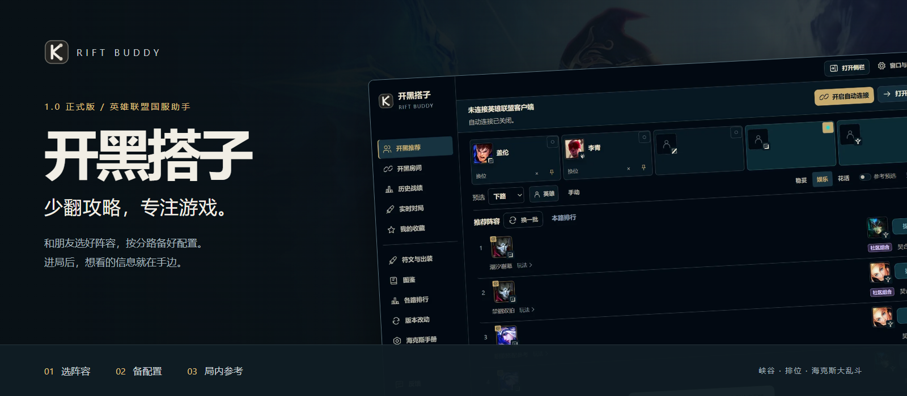
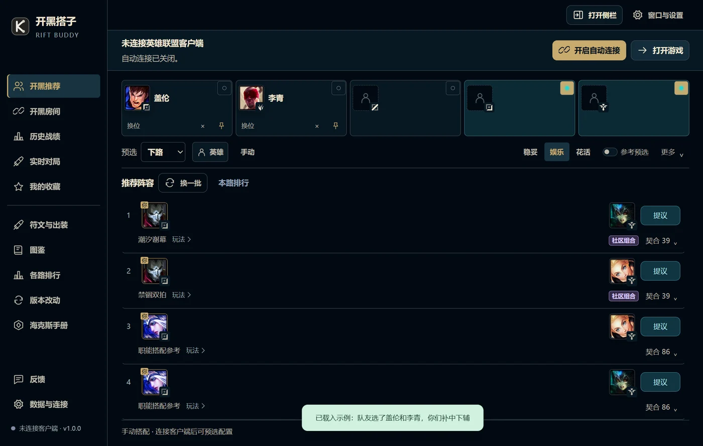
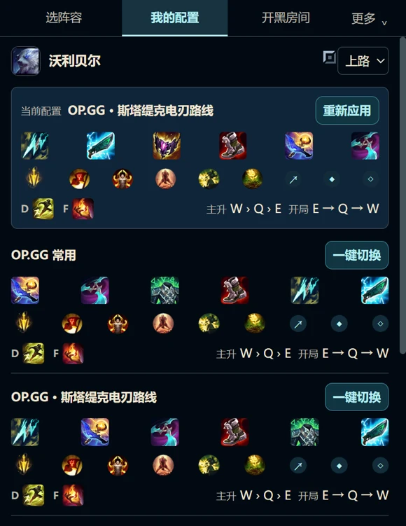
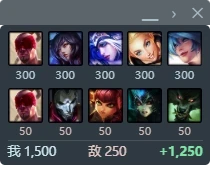
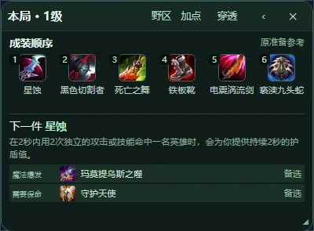
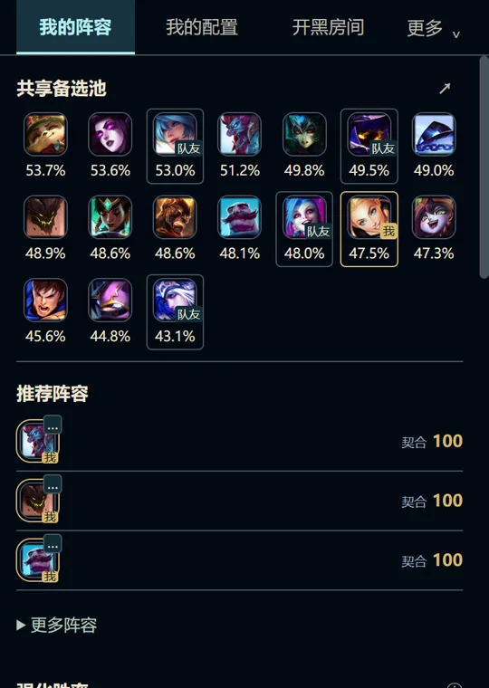
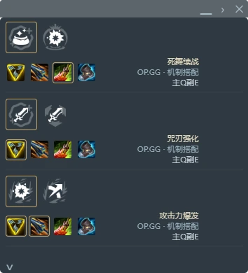

<p align="center">
  <a href="https://room.riftbuddy.dpdns.org/downloads/">
    
  </a>
</p>

<p align="center"><strong>选人有搭子，进局有参考。</strong><br>阵容推荐 · 分路配置 · 局内小窗 · 海克斯大乱斗</p>
<p align="center">
  <a href="https://room.riftbuddy.dpdns.org/downloads/v1.0.0/RiftBuddy-1.0.0-Setup.exe"><strong>↓ 下载 Windows 版</strong></a>　 ·　
  <a href="https://room.riftbuddy.dpdns.org/downloads/">浏览官网</a>　 ·　
  <a href="https://github.com/Legender134/rift-buddy/releases/tag/v1.0.0">GitHub 下载</a>　 ·　
  <a href="https://gitee.com/legender134/rift-buddy/releases/v1.0.0">Gitee 镜像</a>
</p>
<p align="center"><sub>1.0 正式版 · Windows x64 · 免费使用 · 无需注册助手账号</sub></p>

---

## 从选人到进局，少几次来回

开黑搭子把一局游戏的准备连在一起：进入选人时同步队伍，点自己的英雄预选并准备配置，进局后用小窗查看出装、加点和装备价值。支持英雄联盟国服的峡谷、排位与海克斯大乱斗。

| 选阵容 | 备配置 | 进游戏 |
| :--- | :--- | :--- |
| 识别客户端，随游戏组队进入开黑房间 | 点本人英雄，先预选，再准备配置 | 无边框模式下，抬眼看局内小窗 |
| 结合分路、队友和常玩英雄给出候选 | 默认使用 OP.GG 对应分路的常用配置 | 查看出装、加点、刷野路线与装备价值 |
| 提议、投票，一起决定怎么玩 | 社区特有配置放在「我的配置」中自选 | 小窗可展开、收起或贴边 |

## 01 / 选人，一起商量

五路位置、队友选人和阵容候选放在同一个界面里。和朋友讨论方案时，可以直接提议、投票，再点击本人英雄预选。

<a href="docs/images/v1.0.0/draft.webp"></a>

> **分数各有含义。** 契合分用于比较阵容搭配，不代表胜率。社区组合以独立标识呈现，不因来自社区而抬高契合分。统计胜率按标注的来源、版本和样本口径展示。

## 02 / 配置，跟着英雄和分路走

<table>
<tr>
<td width="48%" valign="top">
<a href="deploy/downloads/media/rift-config.webp"></a>
</td>
<td width="52%" valign="top">
<h3>先选好，再配好</h3>
<p>点击推荐中的本人英雄，先在客户端预选，再按英雄与分路准备符文、召唤师技能和商店装备集。最终锁定由你在客户端确认。</p>
<h3>默认常用，玩法自选</h3>
<p>默认采用 OP.GG 对应分路的常用配置。想尝试社区组合的专用配置，可以在「我的配置」中自行切换。</p>
<h3>自己的装备集，留着</h3>
<p>更新时可替换开黑搭子生成的装备集，保留玩家自己创建的装备集。</p>
<p><sub>截图为功能演示。实际配置以软件内的来源、分路和版本标注为准。</sub></p>
</td>
</tr>
</table>

## 03 / 进局，抬眼就能看

小窗把出装顺序、技能加点、刷野路线和双方装备价值留在游戏旁。鼠标悬停可看详情，按习惯展开、收起或贴边。

<table>
<tr>
<td width="42%" align="center" valign="top">
<p><strong>双方装备价值</strong></p>

<p><sub>逐人查看，队伍总值与差值一起看。</sub></p>
</td>
<td width="58%" align="center" valign="top">
<p><strong>当前英雄的出装路线</strong></p>

<p><sub>当前这套配置，留在手边。</sub></p>
</td>
</tr>
</table>

**小窗需要游戏使用无边框模式。** 进局前可按助手提示一键切换。已经在局内时，在游戏的「Esc → 视频 → 窗口模式」选择无边框并应用。经济窗口显示的是**装备价值**，不是身上持有的金币或完整对局总经济。

## 海克斯大乱斗，也有专门的参考

选人时看共享备选池，进局后围绕当前英雄的强化找搭配。英雄、核心强化、核心装备和加点连在同一条路线里。

<table>
<tr>
<td width="52%" align="center" valign="top">
<p><strong>选人时 · 共享备选池</strong></p>
<a href="deploy/downloads/media/hex-pool.webp"></a>
<p><sub>备选英雄、胜率参考和我方选人标记放在一起。</sub></p>
</td>
<td width="48%" align="center" valign="top">
<p><strong>进局后 · 强化与出装</strong></p>
<a href="deploy/downloads/media/hex-overlay.webp"></a>
<p><sub>查看强化搭配与核心装备，常用路线可以置顶。</sub></p>
</td>
</tr>
</table>

海克斯资料按游戏版本区分。截图为界面演示，实际请查看软件内的来源与版本标注。

## 想查的，也在这里

| 功能 | 可以做什么 |
| :--- | :--- |
| **历史战绩与推荐偏好** | 查看战绩，了解常玩英雄，调节推荐对熟悉英雄的偏好 |
| **英雄、装备与符文图鉴** | 查看详细效果与机制说明 |
| **各路排行与版本改动** | 查看分路统计与已收录的改动，核对来源和版本 |
| **收藏与个人配置** | 保存喜欢的方案与配置，留给下一局 |

## 三步开始

1. **安装并打开。** 下载完整安装包，打开开黑搭子与英雄联盟客户端。
2. **进选人，点头像。** 在侧栏查看阵容，点本人英雄预选并准备配置，再去客户端确认锁定。
3. **无边框，抬眼看。** 进局前按提示切换无边框，游戏中用小窗查看参考。

**下载 1.0 正式版** → [完整安装包（约 143 MiB）](https://room.riftbuddy.dpdns.org/downloads/v1.0.0/RiftBuddy-1.0.0-Setup.exe) · [GitHub](https://github.com/Legender134/rift-buddy/releases/tag/v1.0.0) · [Gitee](https://gitee.com/legender134/rift-buddy/releases/v1.0.0) · [SHA-256 校验](https://room.riftbuddy.dpdns.org/downloads/v1.0.0/SHA256SUMS-1.0.0.txt)

<details>
<summary><strong>已经安装？查看增量更新与镜像下载说明</strong></summary>

在「数据与连接 → 软件更新」检查更新。适用的补丁会在助手退出后后台安装，完成后自动打开新版，保留收藏和个人配置。

- **0.59.79 → 1.0.0**：[专用增量补丁（约 315 KiB）](https://room.riftbuddy.dpdns.org/downloads/v1.0.0/RiftBuddy-1.0.0-From-0.59.79-Update.exe)。仅适用于对应旧版本，其他版本请使用完整包。
- **Gitee 手动下载**：将全部分卷与 `Merge.cmd` 放在同一文件夹，运行 `Merge.cmd` 合并生成完整安装包。

</details>

<details>
<summary><strong>连接、局内小窗或配置遇到问题？</strong></summary>

先确认助手显示已连接并识别当前英雄。小窗不可见时，核对游戏是否为无边框模式，并查看「数据与连接」中的窗口设置。

可以在软件左下角反馈，也可以提交 [GitHub Issue](https://github.com/Legender134/rift-buddy/issues)。请说明软件版本、游戏模式、具体操作和现象，附必要截图。不要附客户端口令或其他凭据。

更多操作见[使用指南](使用说明.txt)。

</details>

<details>
<summary><strong>隐私、操作边界与资料来源</strong></summary>

助手无需注册账号，不自动锁定英雄、购买装备或升级技能。符文写入由玩家在应用中点击触发。

逐局战绩和备注仅在本机当前运行内存中保留。加入开黑房间会共享协作所需状态以及有界的英雄场次摘要、偏好，不上传逐局战绩。反馈仅在主动提交时发送填写的文字、选中的图片和应用版本。

基础资料可离线查看。统计、常用配置与社区玩法标注来源和版本，静态资料不作为胜率证据。详见[资料来源与许可](THIRD_PARTY_NOTICES.md)。

</details>

<details>
<summary><strong>开发与贡献</strong></summary>

使用 Windows 原生 Node.js 24 与 pnpm 11.25.0。开发前请阅读 [AGENTS.md](AGENTS.md)。

```powershell
pnpm install --frozen-lockfile
pnpm start
```

提交前运行 `pnpm test`、`pnpm check`，并按改动验证打包后的应用。Electron 主进程与预加载在 `electron/`，界面在 `src/`，共享推荐逻辑在 `src/core/`。

README 下载入口指向已发布的 **1.0.0**，`main` 可能包含发布后的文档或开发改动。

</details>

---

<p align="center"><strong>开黑搭子 · Rift Buddy</strong><br><sub>独立玩家项目，与 Riot Games、腾讯无隶属关系。游戏资料与图像归原权利人所有。</sub></p>
<p align="center"><a href="https://room.riftbuddy.dpdns.org/downloads/">官网</a> · <a href="https://github.com/Legender134/rift-buddy/issues">反馈</a> · <a href="THIRD_PARTY_NOTICES.md">资料来源与许可</a></p>
